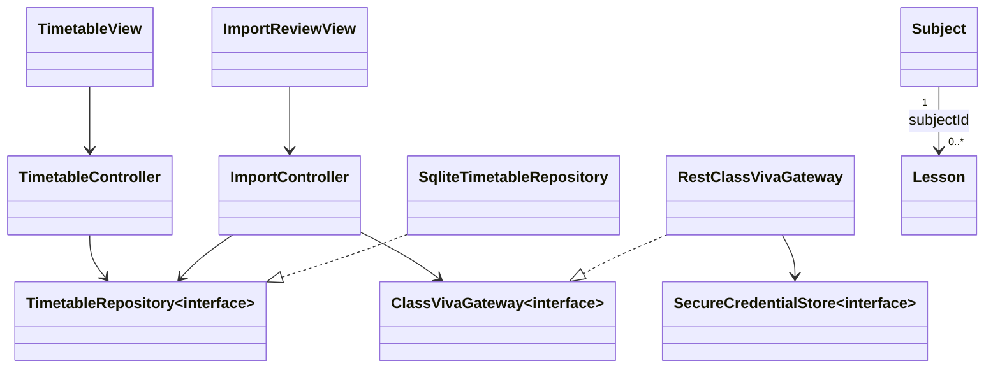

# Architettura applicativa

## Obiettivo

Applicazione Flutter Android/iOS, locale-first, per creare un orario settimanale ricorrente e importare una proposta dalle lezioni ClasseViva della settimana precedente. Nessun server applicativo.

## MVC

- **View**: widget Flutter stateless o componenti di presentazione. Leggono lo stato esposto dal controller e invocano comandi; non conoscono database, HTTP né credenziali.
- **Controller**: coordinano casi d'uso asincroni e stato di presentazione, gestiscono errori e comandano navigazione. Dipendono da contratti, non da plugin.
- **Model**: entità immutabili, validazioni di dominio e interfacce repository/gateway. Gli adapter concreti sono infrastruttura del model.
- **Composition root**: `main.dart` crea gli adapter e li inietta nei controller. Non si usano service locator globali o istanze nascoste.

## Modello di dominio

`Subject` rappresenta una materia (`id`, `name`, `colorValue`). `Lesson` rappresenta una ricorrenza (`id`, `subjectId`, giorno ISO 1-7, minuti dall'inizio del giorno per inizio e fine). Un `Timetable` raccoglie materie e lezioni. Gli intervalli sono [inizio, fine): due lezioni adiacenti sono valide, sovrapposizioni nello stesso giorno non lo sono. Materie e lezioni sono persistite atomicamente; l'eliminazione di una materia rimuove le sue lezioni.

Una proposta importata è un insieme temporaneo di lezioni, non salvato finché lo studente non la conferma. Le lezioni reali sono aggregate per giorno della settimana e fascia oraria. Orari incoerenti, materia ambigua o righe duplicate sono segnalati prima della conferma.

## Flusso dati

Percorso di importazione: View → ImportController → gateway di ClasseViva → mapper della risposta → proposta in memoria → revisione/approvazione → repository locale. Login e token restano in secure storage, mai nel database o nei log.

## Integrazione ClasseViva

L'adapter REST implementa login e lettura lezioni per intervallo. Richieste e parsing sono separati per poter sostituire endpoint e schema senza cambiare controller o UI. Gestire timeout, assenza rete, credenziali errate, sessione scaduta, limitazioni dell'account e JSON inatteso con errori tipizzati. Nessun refresh automatico aggressivo.

Le API consultate sono documentazione comunitaria/non ufficiale. L'endpoint delle lezioni fornisce data, materia, numero dell'ora e durata, non orari di campanella: l'utente configura per ogni numero ora il relativo intervallo. Senza una mappatura completa la proposta segnala le ore mancanti e non consente conferma parziale. Verificare login e accesso da account studente con account autorizzato; mantenere la creazione manuale sempre disponibile. La prova con account reale è manuale, mai automatizzata nei test.

## Persistenza e sicurezza

SQLite locale tramite repository e schema versionato. Token e identificativo studente sono conservati tramite Keychain/Keystore (`flutter_secure_storage`); la password non viene conservata. Logout elimina token e identificativo; i dati orario restano locali. Non registrare header, password, token o payload personali. Tutte le richieste usano TLS.
